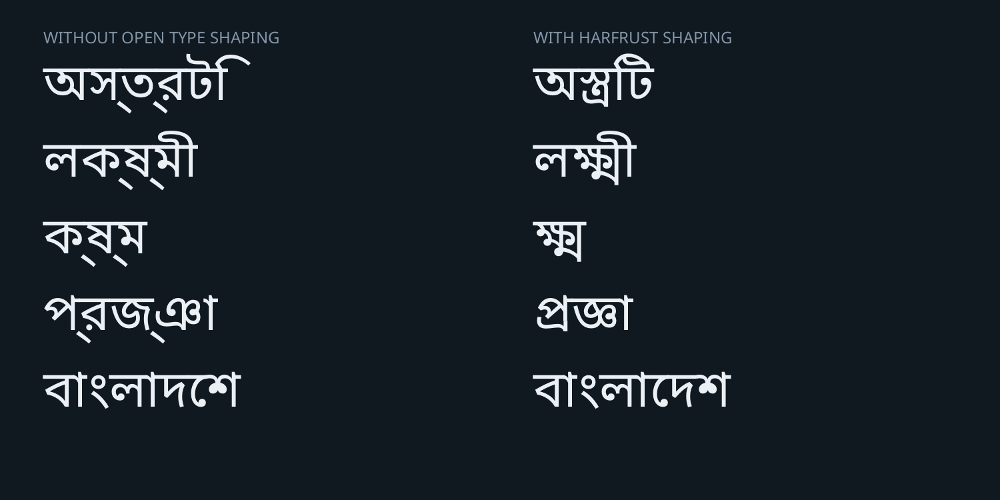

# BornoForge

[](https://www.rust-lang.org/)
[](LICENSE)
[](#)

**BornoForge** is a high-performance, pure-Rust CLI tool and font optimization pipeline built on Google's Fontations ecosystem, including `harfrust`, `skera`, and `read-fonts`.

It is a build-time font optimization tool for game developers working with Bengali localization. It generates compact, corpus-specific font subsets while validating that important OpenType shaping behavior is preserved. It is designed to integrate into existing game development workflows without requiring a custom runtime rendering pipeline, provided the target engine supports the required font and shaping features.

## Why Bengali Shaping Matters

Bengali is a complex script that requires contextual glyph substitution and positioning to render correctly. Without adequate OpenType shaping support, conjuncts (*Juktakkhar*) and vowel signs (*Kar*) may appear incorrectly.

The following examples illustrate the difference between unshaped character sequences and properly shaped Bengali text.



BornoForge addresses the font optimization side of this problem. It generates compact font subsets tailored to your localization corpus while validating that the original font's shaping behavior is preserved.

**Smaller font assets. Preserved Bengali shaping. No custom runtime rendering pipeline required.**

## ✨ Features

### 1. Dual Optimization Modes

BornoForge offers two optimization strategies depending on how your game uses text.

- **Static Mode (`--mode static`)**

  Achieves approximately **90% font size reduction** for fixed narrative scripts and predefined localization strings.

  Uses `NO_LAYOUT_CLOSURE` alongside a custom **Self-Healing Akshara Micro-Closure** algorithm. This approach isolates problematic Bengali syllables and discovers intermediate glyphs generated during OpenType `GSUB` substitutions, without unnecessarily including unrelated glyph combinations.

- **Dynamic Mode (`--mode dynamic`)**

  Achieves approximately **80% font size reduction** while retaining the full OpenType `GSUB`/`GPOS` layout closure for the characters present in your localization corpus.

  Suitable for runtime-generated text, chat systems, and dynamic player names where text combinations cannot be fully predicted in advance.

### 2. Shaping-Diff Verification

Font subsetting should never silently break text shaping.

BornoForge includes a shaping verification pipeline that processes localization strings using `harfrust` and compares the shaping results produced by the original font and the generated subset.

It checks for matching:

- Glyph counts
- Glyph clusters
- Horizontal and vertical advance widths (`x_advance`, `y_advance`)
- Glyph offsets (`x_offset`, `y_offset`)

This provides a numerical shaping-equivalence check for detecting differences introduced during font optimization.

### 3. SDF-Oriented Font Stripping

For game engines using Signed Distance Field (SDF) text rendering, certain legacy font tables may be unnecessary.

BornoForge can strip selected variable-font tables:

- `gvar`
- `HVAR`
- `fvar`
- `avar`
- `STAT`

It also removes legacy TrueType hinting tables:

- `fpgm`
- `prep`
- `cvt `

This reduces unnecessary font data for rendering pipelines that do not rely on these features.

### 4. Recursive Localization Scanning

BornoForge accepts either an individual localization file or an entire directory.

Supported formats:

- JSON (`.json`)
- CSV (`.csv`)
- Plain text (`.txt`)
- Gettext Portable Object (`.po`)
- SubRip subtitles (`.srt`)

It extracts and deduplicates the required Bengali characters and syllables across the supplied corpus, avoiding redundant processing of repeated text.

## 📊 Benchmarks

Benchmarks were performed using `NotoSansBengali-Regular.ttf` on a desktop workstation.

| Corpus | Mode | Output Size | Reduction | Unique Glyphs Kept | Shaped Glyph Instances Verified | Build Time |
|:--|:--|--:|--:|--:|--:|--:|
| **RPG UI** (`bn.json`) | Static | 36.56 KB | **91.9%** | 116 / 730 | 346 | 148.48 ms |
| **RPG UI** (`bn.json`) | Dynamic | 85.37 KB | **81.1%** | 275 / 730 | 346 | 73.14 ms |
| **Pather Panchali** (`.srt`) | Static | 76.40 KB | **83.1%** | 258 / 730 | 24,484 | 187.77 ms |
| **Pather Panchali** (`.srt`) | Dynamic | 108.54 KB | **76.0%** | 373 / 730 | 24,484 | 113.46 ms |

*Build times represent release-mode execution. Results may vary depending on hardware and corpus size. Unique Glyphs Kept represents the number of distinct glyphs retained in the optimized font. Shaped Glyph Instances Verified represents the total number of glyph instances verified across the localization corpus. For example, the Pather Panchali static subset retains 258 unique glyphs while successfully verifying 24,484 shaped glyph instances across 1,297 subtitle lines.*

## 🚀 Installation

### Build from Source

Make sure you have the Rust toolchain installed.

```bash
git clone https://github.com/Askeleid/BornoForge.git
cd BornoForge
cargo build --release
```

The compiled binary will be available under `target/release/`.

## 🛠️ Usage

### Static Mode

For fixed narrative scripts, predefined dialogue, and UI localization:

```bash
cargo run --release -- \
  --locale assets/bn.json \
  --font assets/NotoSansBengali-Regular.ttf \
  --output assets/NotoSansBengali-Static.ttf \
  --mode static
```

### Dynamic Mode

For runtime-generated text, chat systems, and player-generated content:

```bash
cargo run --release -- \
  --locale assets/locales/ \
  --font assets/NotoSansBengali-Regular.ttf \
  --output assets/NotoSansBengali-Dynamic.ttf \
  --mode dynamic \
  --verbose
```

## 🧪 Interactive Shaping Demo

BornoForge also includes a browser-based Bengali shaping demonstration powered by HarfRust compiled to WebAssembly.

The demo allows you to enter Bengali text and compare glyph rendering without OpenType shaping against HarfRust-shaped output, alongside the underlying glyph information.

[View the demo source](https://askeleid.github.io/BornoForge/web-demo/index.html)

To run the demo locally, start a server from the project root:

```bash
python -m http.server 8000
```

Then open:

```text
http://localhost:8000/web-demo/index.html
```

The demo uses the Bengali font included in the `assets/` directory.

## 🧪 Testing

BornoForge includes a test suite covering Bengali OpenType shaping and font optimization across both modes.

Run the tests with:

```bash
cargo test
```

## 📄 License

BornoForge is released under the MIT License. See [LICENSE](LICENSE) for details.

---

**Built to make Bengali localization a little less painful.**
